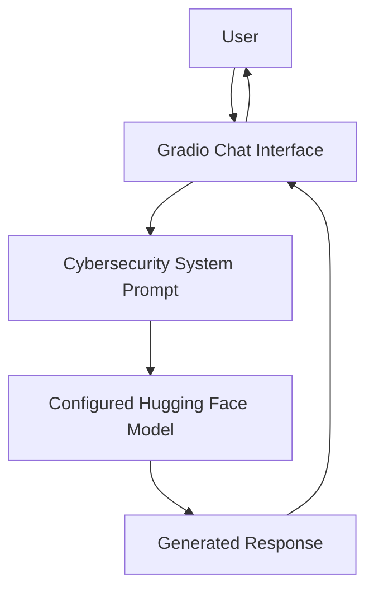
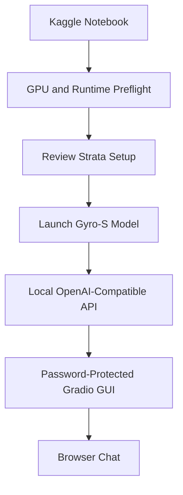

# Qwen3.8-Cyber-AI

> An experimental AI assistant for cybersecurity learning and defensive security exploration, with a separate Kaggle workflow for the 125B Gyro-S model.

<p align="center">
  <a href="https://www.python.org/"></a>
  <a href="https://www.gradio.app/"></a>
  <a href="https://www.kaggle.com/"></a>
  <a href="LICENSE"></a>
  
</p>

**Note:** This is an independent experimental project, not an official Qwen release. It does not create or claim ownership of Qwen model weights. The starter app defaults to `Qwen/Qwen3-4B`; the separate notebook explores a 125B Gyro-S workflow.

---

## Overview

Qwen3.8-Cyber-AI is an experimental AI assistant project designed to make cybersecurity concepts easier to explore through a browser-based chat interface.

The project focuses on:

- Cybersecurity fundamentals and defensive security education.
- Networking, Linux, Windows security, and SOC learning.
- Authorized lab practice and security-awareness guidance.
- Running model experiments in Kaggle GPU environments.
- A simple Gradio interface for interacting with a configured language model.

This repository is a learning and experimentation project—not a production security product, a validated SOC platform, or a substitute for professional security review.

## Project status

<sub>Early development · Experimental · Contributions welcome</sub>

The starter application and setup documentation are provided in this repository. Model downloads, GPU compatibility, notebook execution, and end-to-end inference must be verified in the user's own runtime. **A successful live run is not claimed by this README.**

## Key capabilities

| Capability | Description |
|---|---|
| Configurable model | Select a Hugging Face causal language model using an environment variable |
| Optional 4-bit loading | Reduce model memory requirements when the model and runtime support BitsAndBytes |
| Browser chat UI | Interact with the model through Gradio |
| Cybersecurity guidance | Use defensive, educational system instructions |
| Kaggle workflows | Starter setup plus a separate experimental Strata notebook |
| Safety-first scope | Intended for authorized labs, learning, and defensive use |

## Architecture

### Starter application



### Experimental 125B workflow



The experimental path depends on the hardware actually assigned to the Kaggle session, model availability, and runtime limits. The diagram describes the intended workflow, not a guarantee of successful execution.


## Model paths

### 1. Starter model — Transformers

The starter application uses:

- Default model ID: `Qwen/Qwen3-4B`
- Hugging Face Transformers
- Optional BitsAndBytes 4-bit quantization
- Gradio browser interface

You can change the model using the `MODEL_ID` environment variable. Hardware requirements vary by model, context length, precision, and runtime configuration.

### 2. Experimental — Qwen3.8-Flash-Next 125B Gyro-S

The repository also contains a separate Kaggle notebook for experimenting with the **125B Gyro-S** model through **Strata**.

- Target configuration documented by this project: **2 × NVIDIA Tesla T4**.
- The notebook checks the visible GPU count before proceeding.
- The workflow is experimental; Kaggle hardware availability and compatibility are not guaranteed.
- Review the setup instructions and linked technical documentation before executing cells.
- Do not assume that model memory estimates guarantee a successful load.

**Open the experimental workflow:**

- [Kaggle notebook source](notebooks/qwen38_flash_next_125b_gyro_s_t4x2.ipynb)
- [125B Gyro-S Kaggle setup guide](docs/kaggle_125b_gyro_s.md)
- [Strata model documentation](https://github.com/Niko1221/Strata/blob/main/docs/MODELS.md)
- [Strata Gyro documentation](https://github.com/Niko1221/Strata/blob/main/docs/GYRO.md)
- [Model repository](https://huggingface.co/agentionai/Qwen3.8-Flash-Next-Gyro-GGUF)

## Quick start — Starter application

### Requirements

- Python 3.10 or newer.
- A compatible operating system and Python environment.
- An NVIDIA GPU is recommended for local model inference; CPU execution may be slow.
- Hugging Face access token only if your selected model requires gated access.

### 1. Clone the repository

```bash
git clone https://github.com/Thakurdhaval/Qwen3.8-Cyber-AI.git
cd Qwen3.8-Cyber-AI
```

### 2. Install dependencies

Install a PyTorch build compatible with your operating system and hardware. In Kaggle, prefer the preinstalled PyTorch unless the project dependencies require a compatible adjustment.

Then run:

```bash
pip install -r requirements.txt
```

### 3. Configure the model (optional)

Linux/macOS:

```bash
export MODEL_ID=Qwen/Qwen3-4B
```

Windows PowerShell:

```powershell
$env:MODEL_ID = "Qwen/Qwen3-4B"
```

### 4. Launch the chat interface

```bash
python app/gradio_app.py
```

Open the local Gradio URL printed in the terminal.

To enable a temporary public Gradio share link, set `GRADIO_SHARE=true` before launch. Anyone who obtains that link may be able to access the interface while it is active. Do not use public sharing for confidential conversations or sensitive data.

## Run in Kaggle

### Starter Transformers workflow

Follow [the Kaggle starter setup guide](docs/kaggle_setup.md).

### Experimental 125B Gyro-S workflow

1. Open the [Kaggle Notebook Editor](https://www.kaggle.com/code).
2. Choose **File → Load from URL**.
3. Paste the raw notebook URL:

   `https://raw.githubusercontent.com/Thakurdhaval/Qwen3.8-Cyber-AI/main/notebooks/qwen38_flash_next_125b_gyro_s_t4x2.ipynb`

4. Select a GPU runtime and confirm that the session actually exposes the required hardware.
5. Read the notebook's warnings and review third-party setup code before running it.
6. Execute the preflight checks before starting model downloads or launch steps.

See [the detailed 125B setup guide](docs/kaggle_125b_gyro_s.md).

The notebook's Gradio GUI is intended to run only for the lifetime of the active Kaggle session. Its share URL is temporary. Use the authentication settings documented in the notebook, and never publish credentials or API keys.

## Repository structure

```text
Qwen3.8-Cyber-AI/
├── app/
│   └── gradio_app.py
├── config/
│   └── system_prompt.txt
├── docs/
│   ├── kaggle_setup.md
│   ├── kaggle_125b_gyro_s.md
│   └── security.md
├── notebooks/
│   └── qwen38_flash_next_125b_gyro_s_t4x2.ipynb
├── .gitignore
├── LICENSE
├── README.md
└── requirements.txt
```

## Configuration

The starter application supports these environment variables:

| Variable | Default | Purpose |
|---|---|---|
| `MODEL_ID` | `Qwen/Qwen3-4B` | Hugging Face model identifier |
| `LOAD_IN_4BIT` | `true` | Enable 4-bit loading when supported |
| `MAX_NEW_TOKENS` | `512` | Maximum number of generated tokens |
| `GRADIO_SHARE` | `false` | Enable a temporary Gradio share link |

Check the application source for the exact accepted values and behavior before changing deployment settings.

## Security and responsible use

This project is intended for:

- Cybersecurity education and awareness.
- Defensive security learning and analysis.
- Authorized, isolated lab environments.
- Understanding security concepts and safe troubleshooting.

Do not use this project to:

- Access systems, accounts, or networks without explicit permission.
- Steal credentials or personal information.
- Create or deploy malware.
- Disrupt services or evade security controls.
- Process confidential or sensitive data through an untrusted public endpoint.

### Protect your credentials

- Never commit Hugging Face tokens, Kaggle API tokens, passwords, or private keys.
- Store secrets using the platform's secret-management feature (for example, Kaggle Secrets).
- Keep public Gradio sharing disabled unless you understand the exposure.
- Review third-party code before running it.
- Treat AI-generated security advice as untrusted until independently verified.

Read the [Security Guide](docs/security.md) before using the project.

## Limitations

- AI responses may be inaccurate, incomplete, outdated, or unsafe.
- Model output is not a substitute for official documentation or expert review.
- Quantization may affect response quality and does not guarantee that a model will fit in available memory.
- GPU availability, internet access, storage, and session duration depend on the runtime provider.
- A temporary Gradio share link is not a production deployment.
- This repository does not include model weights.
- The experimental 125B workflow has not been represented as successfully validated in every Kaggle environment.

## Roadmap

Planned improvements may include:

- [ ] Improve the chat interface and conversation controls.
- [ ] Add clearer runtime diagnostics and dependency checks.
- [ ] Add structured cybersecurity learning modes (Networking, Linux, Windows, and SOC).
- [ ] Add safe, reproducible defensive lab examples.
- [ ] Improve error handling and model-loading guidance.
- [ ] Add automated tests and continuous integration.
- [ ] Document reproducible benchmark results from verified hardware.
- [ ] Explore additional model backends and deployment options.

Roadmap items are intentions, not promises or completed features.

## Contributing

Contributions, bug reports, and suggestions are welcome.

1. Fork the repository.
2. Create a feature branch.
3. Make a focused change.
4. Test the change in an appropriate environment.
5. Submit a pull request with a clear description.

Do not submit credentials, private data, malware, or instructions intended for unauthorized activity.

## License

This project is distributed under the [MIT License](LICENSE).

## References

- [Qwen models on Hugging Face](https://huggingface.co/Qwen)
- [Hugging Face Transformers documentation](https://huggingface.co/docs/transformers/index)
- [BitsAndBytes documentation](https://huggingface.co/docs/bitsandbytes/index)
- [Gradio documentation](https://www.gradio.app/docs)
- [Kaggle Notebooks](https://www.kaggle.com/code)
- [Strata repository](https://github.com/Niko1221/Strata)
- [Qwen3.8-Flash-Next Gyro GGUF model](https://huggingface.co/agentionai/Qwen3.8-Flash-Next-Gyro-GGUF)

---

<p align="center">
  <strong>Built for learning, experimentation, and defensive cybersecurity.</strong>
  <br/>
  Maintained by <a href="https://github.com/Thakurdhaval">Dhaval</a>
</p>

## Credits and external components

The experimental notebook uses a [third-party Strata setup helper](https://github.com/iAmAjayTeli/devzonex-strata-kaggle), pinned to [a specific upstream commit](https://github.com/iAmAjayTeli/devzonex-strata-kaggle/commit/ca775962d90a7bc2a4b2db6eecb052e0e399c94c) for reproducibility. Review the source code and dependencies before execution.

The project-specific configuration, notebook integration, cybersecurity learning focus, and documentation in this repository are maintained as part of this project. Third-party components remain subject to their respective upstream licenses and terms.
